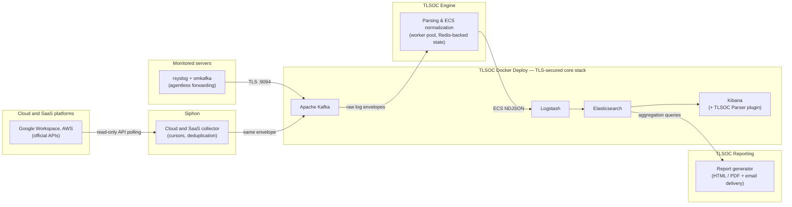

  

<h1 align="center">TLSOC</h1>

  <b>An open-source Security Operations Platform delivering SIEM capabilities through agentless log collection, ECS-normalized parsing, centralized analytics, and automated reporting.</b>

  <i>Built on Kafka, Elasticsearch, Kibana, and other proven open-source technologies — extending them, not replacing them.</i>

  
  
  
  
  

  <a href="#why-tlsoc">Why TLSOC</a> •
  <a href="#quick-start">Quick Start</a> •
  <a href="docs/architecture.md">Architecture</a> •
  <a href="#ecosystem-repositories">Repositories</a> •
  <a href="docs/roadmap.md">Roadmap</a> •
  <a href="CONTRIBUTING.md">Contributing</a>

---

## Overview

**TLSOC** is a free and open-source Security Operations Platform. It provides agentless
log collection from Linux servers, collection from cloud and SaaS platforms such as
Google Workspace through [Siphon](https://github.com/trustlab-org/siphon), TLS-secured transport through Apache Kafka,
parsing and normalization into
[Elastic Common Schema (ECS)](https://www.elastic.co/guide/en/ecs/current/index.html)
events, centralized storage and dashboards on the Elastic Stack, and automated daily
executive reports in HTML and PDF.

TLSOC delivers core **Security Information and Event Management (SIEM)** capabilities —
collection, normalization, storage, search, and visualization of security events —
through a modular architecture, while providing the deployment automation, parser
management, and reporting tooling needed to build and operate a lightweight security
operations environment.

This repository serves as the **central entry point** for the TLSOC ecosystem,
providing architecture, documentation, standards, and cross-project guidance. The
implementation is maintained in the component repositories listed below.

## Project Status

TLSOC is under **active development**. Current focus:

- Engine hardening and expanded parser coverage
- Unified ecosystem documentation
- Reporting profiles beyond web access
- Growing the parser ecosystem

See the [roadmap](docs/roadmap.md) for what is shipped, in progress, and planned.

## Why TLSOC?

TLSOC is designed for organizations that need a lightweight, transparent, and fully
open-source security monitoring platform without relying on proprietary agents or
vendor lock-in.

- **Agentless log collection** — monitored servers forward logs with native Linux
  tooling (`rsyslog` + `omkafka`); nothing custom is installed or left running on
  source machines.
- **Cloud and SaaS sources**: audit logs from platforms such as Google Workspace
  are pulled through their official APIs by [Siphon](https://github.com/trustlab-org/siphon), with read-only access and
  nothing installed on the platform side.
- **TLS-secured pipeline** — communication across the monitoring pipeline is
  encrypted, signed by a locally generated certificate authority you control.
- **ECS-normalized events** — one schema across all sources, interoperable with the
  broader Elastic ecosystem.
- **Modular architecture** — independently deployable components that compose into
  one platform; adopt only what you need.
- **YAML-driven configuration** — parsers, report definitions, and detections are
  configuration files, not custom code.
- **Designed for self-hosters** — universities, research institutions, and any
  environment that wants full ownership of its security data.

## Engineering Philosophy

TLSOC is intentionally built **on top of** established open-source infrastructure
rather than replacing it. Instead of reimplementing mature technologies such as
Kafka, Bento, Elasticsearch, Kibana, or Logstash, TLSOC integrates them into a cohesive
platform and focuses development effort on the problems they do not solve out of
the box:

| Proven infrastructure (integrated) | TLSOC contributions (built here) |
|---|---|
| Apache Kafka — transport and buffering | Agentless onboarding and one-command deployment automation |
| Elasticsearch — storage and search | TLS-secured, ready-to-deploy stack architecture |
| Kibana — dashboards and exploration | YAML-driven parser framework with ECS normalization |
| Logstash — indexing pipeline | Rule validation, golden-sample testing, and parser management tooling |
| rsyslog — native log forwarding | Declarative executive reporting framework |
| Redis — transaction state | Ecosystem standards, operational workflows, and (planned) ML analytics |
| Bento, stream processing | Siphon: cloud and SaaS log collection with per-source cursors, late-event handling, and deduplication |

This approach reuses production-tested infrastructure, stays compatible with the
Elastic ecosystem, reduces maintenance burden, and lets organizations upgrade the
underlying components independently — while TLSOC's engineering effort goes where it
delivers the most value.

In other words, TLSOC is not another logging stack — it is the architecture that
makes established technologies work together for security operations with minimal
operational overhead. The full rationale, design trade-offs, and comparisons
(plain ELK, Elastic Security) are in **[Why TLSOC?](docs/why-tlsoc.md)**.

## Choose the Right Repository

| You want to… | Go to |
|---|---|
| **Deploy TLSOC** (the TLS-secured stack) | [TLSOCDockerDeploy](https://github.com/sankettaware16/TLSOCDockerDeploy) |
| **Develop parser rules** or run the parsing engine | [foss-soc-engine](https://github.com/sankettaware16/foss-soc-engine) |
| **Collect logs from cloud and SaaS platforms** (Google Workspace, AWS) | [siphon](https://github.com/trustlab-org/siphon) |
| **Generate executive reports** | [tlsoc-reporting-framework](https://github.com/sankettaware16/tlsoc-reporting-framework) |
| **Detect anomalies with ML** (behavioral detection) | [tlsoc-machinelearning-framework](https://github.com/sankettaware16/tlsoc-machinelearning-framework) |
| **Read platform documentation** | [tlsoc](https://github.com/sankettaware16/tlsoc) (this repository) |

## Ecosystem Repositories

| Repository | Purpose | Status |
|---|---|---|
| [tlsoc](https://github.com/sankettaware16/tlsoc) | Ecosystem home — documentation, architecture, roadmap, standards | Active |
| [foss-soc-engine](https://github.com/sankettaware16/foss-soc-engine) | High-performance polymorphic log parsing and ECS normalization engine (Kafka consumer, Web UI, Kibana plugin) | Active |
| [siphon](https://github.com/trustlab-org/siphon) | Lightweight, single-binary collector built on Bento that pulls audit logs from cloud and SaaS platforms into Kafka | Active |
| [TLSOCDockerDeploy](https://github.com/sankettaware16/TLSOCDockerDeploy) | One-command, TLS-secured core stack: Kafka + Logstash + Elasticsearch + Kibana via Docker Compose, plus agentless source onboarding | Active |
| [tlsoc-reporting-framework](https://github.com/sankettaware16/tlsoc-reporting-framework) | Declarative, template-driven executive reporting over ELK data — daily HTML/PDF reports with KPIs, charts, and insights | Active |
| [tlsoc-machinelearning-framework](https://github.com/sankettaware16/tlsoc-machinelearning-framework) | Self-learning behavioral anomaly detection over ECS events — learns each environment's normal and alerts on deviation, zero threshold tuning (web_recon directory-enumeration detector shipping) | Testing |
| tlsoc-dashboard | Unified operational dashboard for the platform | Planned |
| tlsoc-parser-plugins | Community-contributed parser rule packs for additional log sources | Planned |
| tlsoc-examples | End-to-end example deployments, sample configurations, and labs | Planned |
| tlsoc-integrations | Connectors for third-party tools (ticketing, alerting, threat intel) | Planned |

## Architecture

**The data journey:**

1. A monitored server forwards each log line to Kafka using `rsyslog` + `omkafka`,
   wrapped in a small JSON envelope that carries routing metadata
   (`org`, `dept`, `env`, `server`, `source_program`).
   Cloud and SaaS sources reach Kafka through **Siphon**, which polls each platform's
   audit-log API and produces events in the same envelope.
2. **TLSOC Engine** consumes the Kafka topics, routes every line to the correct YAML
   parsing rule, normalizes it into an ECS-compliant JSON event (with GeoIP/ASN
   enrichment and accurate event timestamps), and writes NDJSON output files.
3. **Logstash** tails the engine's output and indexes the events into **Elasticsearch**
   over TLS.
4. **Kibana** provides search and dashboards — including an optional native TLSOC Parser
   plugin for managing engine rules from inside Kibana.
5. **TLSOC Reporting** queries Elasticsearch on a schedule and renders daily HTML/PDF
   executive reports, delivered by its email automation component.

Detailed diagrams (component, deployment, Kafka flow, parser pipeline, reporting
pipeline) live in [docs/architecture.md](docs/architecture.md).

## Quick Start

A complete deployment takes four steps. The full walkthrough with commands is in
[docs/quick-start.md](docs/quick-start.md).

| Step | What you do | Where |
|---|---|---|
| 1. Deploy the core stack | Bring up TLS-secured Kafka, Logstash, Elasticsearch, and Kibana with Docker Compose on one server | [TLSOCDockerDeploy](https://github.com/sankettaware16/TLSOCDockerDeploy) |
| 2. Onboard log sources | Run the one-command onboarding script on each Linux server you want to monitor | [TLSOC Docker Deploy — onboarding](https://github.com/sankettaware16/TLSOCDockerDeploy/blob/main/docs/onboarding.md) |
| 2b. Collect cloud and SaaS logs (optional) | Run Siphon with read-only API access to platforms such as Google Workspace | [siphon](https://github.com/trustlab-org/siphon) |
| 3. Start the parsing engine | Install TLSOC Engine, map your sources to parsing rules, run it as a systemd service | [foss-soc-engine](https://github.com/sankettaware16/foss-soc-engine) |
| 4. Enable reporting | Configure TLSOC Reporting and schedule the daily report cron job | [tlsoc-reporting-framework](https://github.com/sankettaware16/tlsoc-reporting-framework) |

## Supported Log Sources

Parsers bundled with [foss-soc-engine](https://github.com/sankettaware16/foss-soc-engine)
today:

| Category | Sources |
|---|---|
| Web servers | ✅ Apache · ✅ NGINX |
| Authentication | ✅ Linux auth (SSH, sudo) |
| Mail | ✅ Postfix · ✅ Roundcube |
| Proxy | ✅ Squid |
| Security tooling | ✅ ModSecurity (WAF) · ✅ Suricata (IDS) · ✅ File integrity monitoring |
| Vulnerability scanners | ✅ OpenVAS · ✅ Nessus |
| Cloud and SaaS (via [Siphon](https://github.com/trustlab-org/siphon)) | ✅ Google Workspace (14 log types, including login, admin, Drive, Gmail, and OAuth tokens) · 🚧 AWS CloudTrail |

Any other source — syslog, JSON, or XML — can be added as a **YAML rule with no
code**; the engine even documents an
[AI master prompt](https://github.com/sankettaware16/foss-soc-engine/blob/main/docs/writing-rules.md)
that generates an ECS-compliant rule from raw log samples.

## Documentation

| Document | Contents |
|---|---|
| [Why TLSOC?](docs/why-tlsoc.md) | The problem, design philosophy, trade-offs, and how TLSOC compares to plain ELK and Elastic Security |
| [Architecture](docs/architecture.md) | High-level, component, data-flow, deployment, Kafka, parser, and reporting diagrams |
| [Quick Start](docs/quick-start.md) | End-to-end deployment walkthrough across all repositories |
| [Ecosystem Standards](docs/ecosystem.md) | Naming conventions, repository structure, and how new repositories join the ecosystem |
| [Branding](docs/branding.md) | Logo, color palette, badges, and README layout used across all repositories |
| [Roadmap](docs/roadmap.md) | Current work, next release, future plans, and long-term vision |
| [FAQ](docs/faq.md) | Frequently asked questions about the platform |

Component-level documentation lives in each repository's own `docs/` directory.

<!-- Screenshots: add Kibana dashboard and report screenshots to docs/images/ and
     reference them here once captured. -->

## Roadmap

The full roadmap, with detail per item, is in [docs/roadmap.md](docs/roadmap.md).

**Current — shipped and maintained**

- ✅ Parsing engine (foss-soc-engine)
- ✅ TLS-secured deployment stack (TLSOCDockerDeploy)
- ✅ Reporting framework (tlsoc-reporting-framework)
- ✅ Agentless onboarding
- ✅ Cloud and SaaS collection with Siphon (Google Workspace)

**In progress**

- 🚧 Unified ecosystem documentation and branding
- 🚧 Versioned, changelog-backed releases
- 🚧 Expanded parser rule library
- 🚧 AWS CloudTrail source in Siphon

**Planned**

- Unified dashboard (tlsoc-dashboard)
- Machine-learning anomaly detection (tlsoc-ml)
- Community parser plugins (tlsoc-parser-plugins)
- Examples and labs (tlsoc-examples)
- Threat-intel and workflow integrations (tlsoc-integrations)
- More Siphon sources: Microsoft 365, Entra ID, Okta, and Google Alert Center

## Contributing

Contributions are welcome across every TLSOC repository — parser rules, report
templates, documentation, and platform features. Start with
[CONTRIBUTING.md](CONTRIBUTING.md); component-specific guides live in each repository.

Please note our [Code of Conduct](CODE_OF_CONDUCT.md).

## Security

TLSOC is security software; we take vulnerabilities in the platform seriously.
Please report them privately as described in [SECURITY.md](SECURITY.md) — do not open
public issues for security problems.

## License

TLSOC is free and open-source software licensed under the
[Apache License 2.0](LICENSE). The license applies to every repository in the
ecosystem unless a repository states otherwise.

---

  Built with ❤️ by <b>TrustLab, IIT Bombay</b> 
  Part of the <a href="https://github.com/sankettaware16/tlsoc">TLSOC Ecosystem</a>

  <a href="https://github.com/sankettaware16/tlsoc">TLSOC</a> •
  <a href="https://github.com/sankettaware16/foss-soc-engine">Engine</a> •
  <a href="https://github.com/sankettaware16/TLSOCDockerDeploy">Deploy</a> •
  <a href="https://github.com/sankettaware16/tlsoc-reporting-framework">Reporting</a> •
  <a href="https://github.com/trustlab-org/siphon">Siphon</a>

