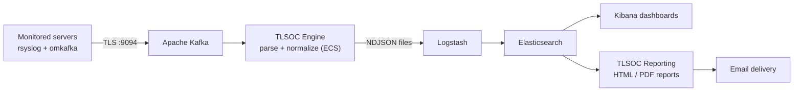
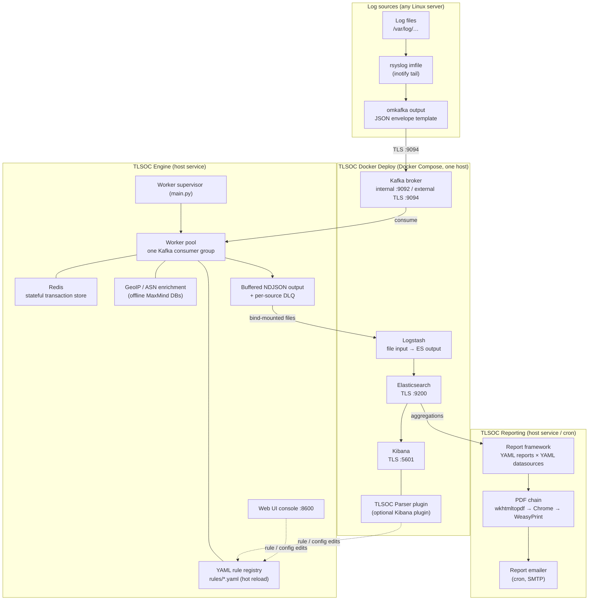
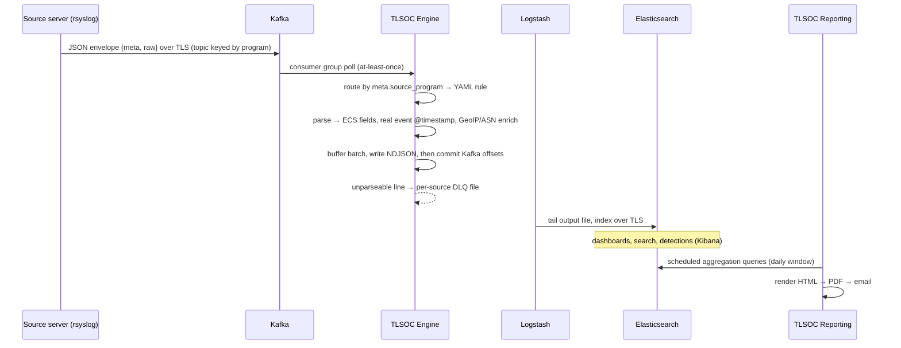
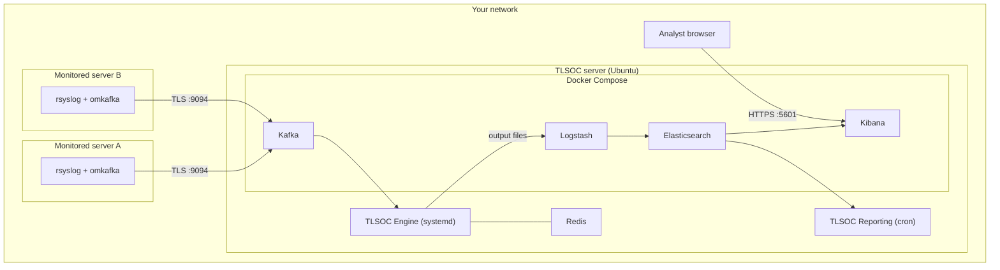
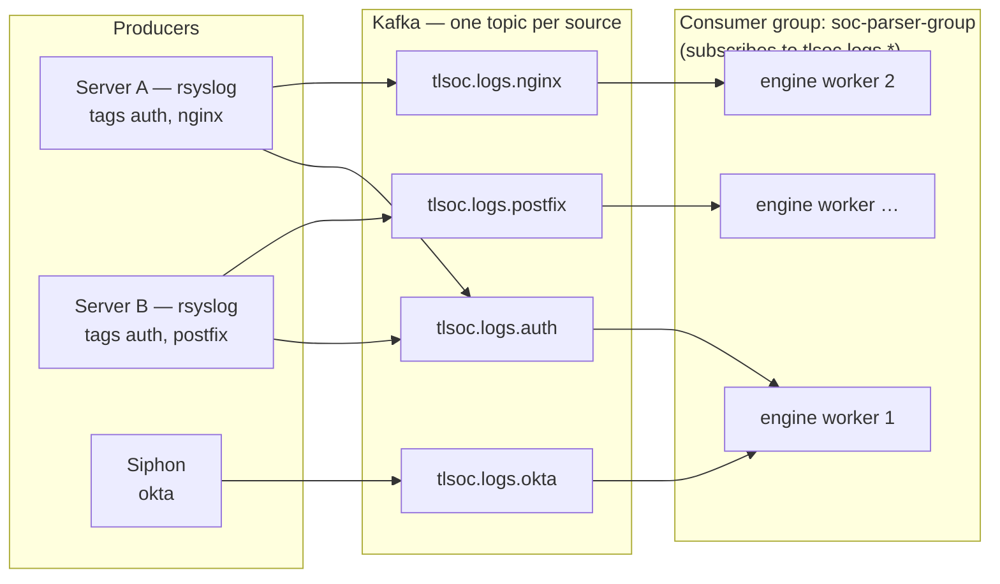
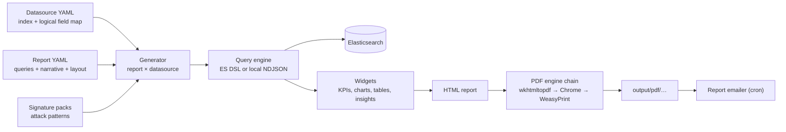

# TLSOC Architecture

This document describes the architecture of the TLSOC platform across all its
repositories. Component-level internals are documented in each repository's own
`docs/` directory; this is the ecosystem-wide view.

## Contents

- [High-level architecture](#high-level-architecture)
- [Component architecture](#component-architecture)
- [Data flow](#data-flow)
- [Deployment topology](#deployment-topology)
- [Communication and ports](#communication-and-ports)
- [Kafka flow](#kafka-flow)
- [Parser pipeline](#parser-pipeline)
- [Reporting pipeline](#reporting-pipeline)

## High-level architecture

TLSOC is a pipeline of four cooperating systems: agentless collection, TLS-secured
transport and storage, ECS normalization, and reporting.



## Component architecture



## Data flow

The life of one log line, end to end:



**The Kafka envelope contract** — every producer (the onboarding script, rsyslog
template, Filebeat, Vector, or a custom script) sends messages of this shape:

```json
{
  "meta": {
    "org": "example_org",
    "dept": "it",
    "env": "production",
    "server": "web_server_1",
    "source_host": "web01",
    "source_program": "nginx_access"
  },
  "raw": "the original log line"
}
```

`meta.source_program` is the routing key that selects the parsing rule;
everything else under `meta` is carried through to the indexed event untouched.

## Deployment topology

The reference deployment uses one central TLSOC server plus any number of
monitored servers. Every arrow crossing a machine boundary is TLS-encrypted.



Scaling out: the engine's workers form a single Kafka consumer group, so you scale
by adding CPU cores on one machine or by running the engine on several machines
with the same `group_id`. The partitions of the per-source topics set the upper
bound on parallelism (one partition is consumed by exactly one worker).

## Communication and ports

| From | To | Protocol / port | Purpose |
|---|---|---|---|
| Monitored servers | Kafka | TLS `:9094` | Log envelope delivery (external listener) |
| TLSOC Engine | Kafka | `kafka:9092` (internal) or TLS `:9094` | Topic consumption |
| TLSOC Engine | Redis | `:6379` (localhost) | Stateful transaction correlation |
| Logstash | Elasticsearch | HTTPS `:9200` | Event indexing |
| Kibana | Elasticsearch | HTTPS `:9200` | Search and dashboards |
| Analysts | Kibana | HTTPS `:5601` | Web access |
| TLSOC Reporting | Elasticsearch | HTTPS `:9200` | Aggregation queries |
| Operators | Engine Web UI | HTTP `:8600` (localhost by default) | Rule/config console |

## Kafka flow

Every log source has its own topic, named after the source: `tlsoc.logs.<source>`.
The same name is the rsyslog tag, the engine rule's `source:` and the index name
part (`fosstlsoc-logs-<source>-*`), so topics and parsers connect by themselves.



Key properties:

- **No topic configuration.** TLSOCDockerDeploy creates the standard topics
  (partitions sized per source); a new source's topic is created on its first
  line, and the engine picks it up within ~30 s. The engine reads a never-seen
  small topic from its first message, so a new source's first lines are kept.
- **Sources are isolated.** A burst from one source (e.g. squid) does not delay the
  others: measured, sso events waited up to 24 s behind a 400k-line squid burst on
  one shared topic, and at most 1.4 s on their own topic.
- **Parallelism.** Within a topic, onboarding spreads lines over all partitions
  (`partitions.auto`), so several workers share a busy source. Partitions cap
  parallelism: one partition is consumed by exactly one worker. Sources whose
  rule correlates multi-line transactions (postfix) use one partition to keep
  order.
- Offsets are committed **only after events are durably written to disk** by the
  engine (at-least-once delivery: duplicates are possible after a crash, silent
  loss is not).
- Older single-topic deployments keep working: the engine routes by
  `meta.source_program` (and `program_mapping`) on any topic it consumes.

## Parser pipeline

Inside TLSOC Engine, every message passes through this pipeline
(full detail: `foss-soc-engine/docs/architecture.md`):

```mermaid
flowchart TB
    IN["Kafka message<br/>{meta, raw} or plain line"] --> ROUTE["Route by source name<br/>program_mapping → rule source/alias → topic name"]
    ROUTE --> STRAT{"Rule strategy"}
    STRAT -->|stateless| RX["Single regex"]
    STRAT -->|multi_match| MM["Pattern list<br/>(prematch gate → regex)"]
    STRAT -->|stateful| SF["Redis transaction<br/>correlate by ID, TTL"]
    STRAT -->|json_map| JM["Dot-path JSON mapping"]
    STRAT -->|xml_xpath| XM["XML element mapping"]
    RX --> NORM
    MM --> NORM
    SF --> NORM
    JM --> NORM
    XM --> NORM
    NORM["ECS field mapping<br/>+ real event @timestamp (UTC)<br/>+ GeoIP / ASN enrichment"] --> OUT["Batched NDJSON output<br/>offset commit after flush"]
    ROUTE -->|no match| DLQ["Per-source DLQ file<br/>+ storm warning"]
    NORM -->|parse failure| DLQ
```



## Reporting pipeline

Inside TLSOC Reporting (full detail: `tlsoc-reporting-framework/docs/architecture.md`):



One report definition multiplies across every datasource with a matching profile —
adding a log source or a report type is a YAML file, never a code change.
